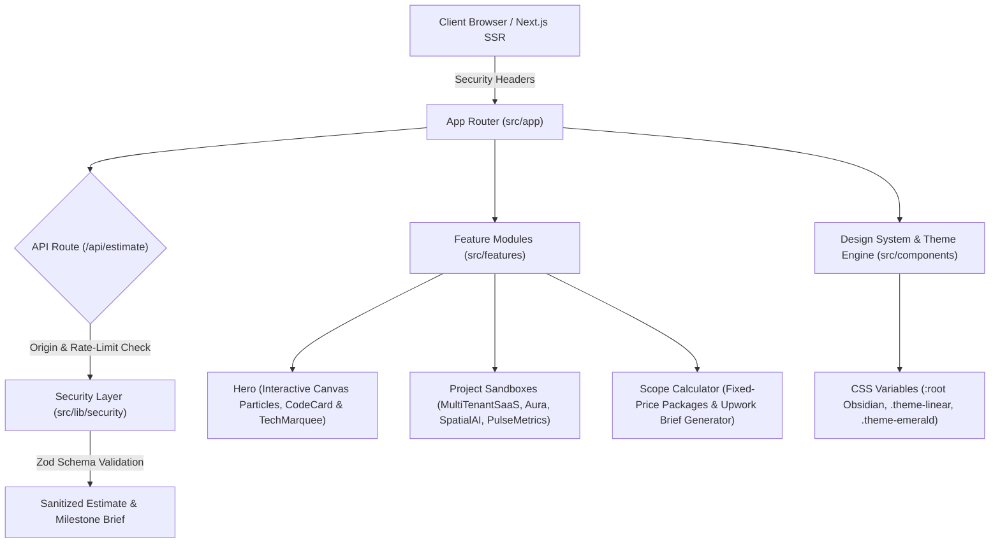

<div align="center">

# Fahim.dev — Full-Stack Developer Portfolio

[](https://nextjs.org/)
[](https://react.dev/)
[](https://www.typescriptlang.org/)
[](https://tailwindcss.com/)
[](https://zod.dev/)

*Personal portfolio built with Next.js 15, strict TypeScript, interactive browser demos, and a quick project estimator.*

[GitHub Repository](https://github.com/FahimInit/my-developer-portfolio) · [Upwork Profile](https://www.upwork.com) · [Issues](https://github.com/FahimInit/my-developer-portfolio/issues)

</div>

---

## 🛠️ Tech Stack & Architecture

Built with a feature-sliced layout separating UI primitives, interactive feature modules, and server utilities.



---

## 📂 Directory Structure

```text
src/
├── app/
│   ├── api/estimate/route.ts     # Rate-limited, Zod-validated estimate endpoint
│   ├── globals.css               # Multi-theme CSS variables & animations
│   ├── layout.tsx                # Root layout & metadata
│   └── page.tsx                  # Home page composing Hero, Work, Skills, Process & Services
├── components/
│   ├── layout/                   # Navbar, Footer, ThemeProvider
│   └── ui/                       # Button, Badge, Card, Modal, SectionHeading
├── config/
│   ├── packages.ts               # Service packages, add-ons & shared Zod schema
│   └── projects.ts               # Featured projects & tech stack groups
├── features/
│   ├── hero/                     # Hero, CodeCard, TechMarquee & interactive ParticleField
│   ├── project-sandboxes/        # ProjectShowcase + Ecommerce, Visualizer & Analytics demos
│   └── scope-calculator/         # Fixed-price package cards & interactive estimate builder
├── lib/
│   ├── env.ts                    # Zod-validated environment config
│   ├── security.ts               # Sliding-window rate limiter, same-origin check & sanitizer
│   └── utils.ts                  # cn() class merger and formatting helpers
└── types/
    └── index.ts                  # Shared TypeScript interfaces
```

---

## 🚀 Getting Started

1. **Clone & install:**
   ```bash
   git clone https://github.com/FahimInit/my-developer-portfolio.git
   cd my-developer-portfolio
   npm install
   ```

2. **Run locally:**
   ```bash
   npm run dev
   ```

3. **Typecheck & production build:**
   ```bash
   npm run typecheck
   npm run build
   ```

---

## 📄 License

MIT
