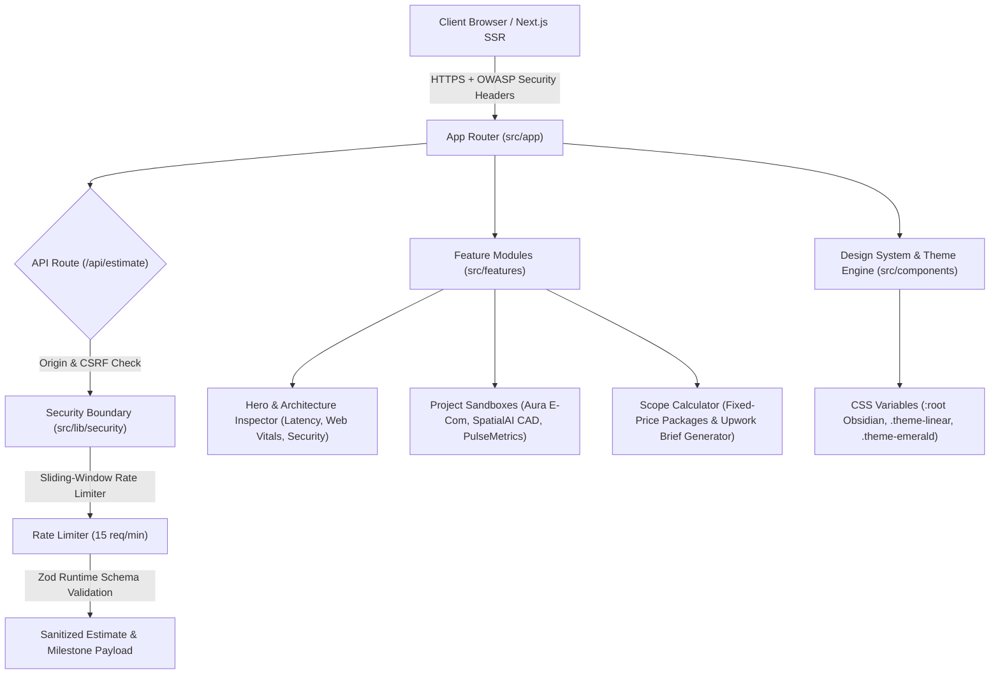

<div align="center">

# Full-Stack Developer Portfolio & Interactive Engineering Showcase

[](https://nextjs.org/)
[](https://react.dev/)
[](https://www.typescriptlang.org/)
[](https://tailwindcss.com/)
[](https://zod.dev/)

*Production-hardened, high-performance developer portfolio built to showcase enterprise architecture, secure API routes, and interactive project sandboxes for Upwork clients and engineering leads.*

[Live Demo](https://localhost:3000) · [Upwork Profile](https://www.upwork.com) · [Report Bug](../../issues)

</div>

---

## 💡 Why This Portfolio Exists

Most developer portfolios are static resumes filled with stock screenshots and generic skill lists. This one is designed for two very specific audiences who evaluate software differently:

1. **Founders & Non-Technical Upwork Clients:** They want to see tangible business outcomes—checkout flows that feel instant, responsive UI that matches designs down to the pixel, and clear, predictable milestone pricing with zero hidden surprises.
2. **Senior Engineering Leads & CTOs:** They want to inspect the GitHub repo—looking for strict TypeScript (`noUncheckedIndexedAccess`, zero `any`), clean domain boundaries, runtime validation with Zod, and defensive security measures (OWASP headers, rate-limiting, and CSRF protection).

---

## 🛠️ Tech Stack & Architecture

This application is engineered using a **Feature-Sliced / Clean Architecture** approach, ensuring strict modular separation between domain logic, UI primitives, and infrastructure utilities.

### System Architecture Diagram



### Core Technologies
- **Framework:** [Next.js 15 (App Router)](https://nextjs.org/) with React 19 Server Components by default.
- **Language:** TypeScript 5.7+ configured with `"strict": true` and `"noUncheckedIndexedAccess": true`.
- **Styling & Tokens:** Tailwind CSS driven by dynamic CSS Custom Properties supporting 3 switchable palettes (Obsidian, Linear Indigo, and Terminal Emerald).
- **Validation:** [Zod](https://zod.dev/) for end-to-end schema validation on incoming JSON payloads and runtime environment variables.
- **Icons & Primitives:** [Lucide React](https://lucide.dev/) + lightweight accessible modal & button primitives.

---

## 📂 Project Directory Structure

```text
src/
├── app/
│   ├── api/
│   │   └── estimate/
│   │       └── route.ts          # Hardened REST endpoint (Rate-limited, Zod-parsed, CSRF-checked)
│   ├── globals.css               # Multi-theme CSS variable palettes (:root, .theme-linear, .theme-emerald)
│   ├── layout.tsx                # Root layout with OpenGraph SEO & metadata boundaries
│   └── page.tsx                  # Server Component entry point composing feature slices
├── components/
│   ├── layout/
│   │   ├── Footer.tsx            # Engineering telemetry footer & external links
│   │   ├── Navbar.tsx            # Sticky glass header with live theme switcher & status badge
│   │   └── ThemeProvider.tsx     # Client context persisting active theme to localStorage
│   └── ui/                       # Atomic design primitives (Button, Badge, Card, Modal)
├── config/
│   ├── packages.ts               # Upwork fixed-price package specs, add-on pricing & Zod schema
│   └── projects.ts               # Featured case study data, tech stack matrix & architecture nodes
├── features/
│   ├── hero-inspector/
│   │   └── HeroInspector.tsx     # Interactive system node graph, Web Vitals audit & security check
│   ├── project-sandboxes/
│   │   ├── AnalyticsSandbox.tsx  # PulseMetrics: Redis cache toggle & simulated webhook burst stream
│   │   ├── EcommerceSandbox.tsx  # Aura: Optimistic cart drawer & dynamic courier rate calculator
│   │   ├── ProjectShowcase.tsx   # Filterable project gallery with inline & modal sandbox launchers
│   │   └── VisualizerSandbox.tsx # SpatialAI: Interactive CAD wireframe vs. 3D render split slider
│   └── scope-calculator/
│       └── ScopeCalculator.tsx   # Fixed-price configurator with live milestone brief generator
├── lib/
│   ├── env.ts                    # Zod-validated server & client environment variables
│   ├── security.ts               # Sliding-window rate limiter, same-origin check & text sanitizer
│   └── utils.ts                  # cn() Tailwind merger and formatting utilities
└── types/
    └── index.ts                  # Shared TypeScript interfaces & domain contracts
```

---

## ⚡ Highlighted Features

### 1. Interactive Architecture & Core Web Vitals Inspector
Instead of static text claims, visitors can test an interactive inspector right in the hero section:
- **Architecture Pipeline:** Click through each infrastructure layer (`Next.js RSC` → `Zod Guard` → `Node.js API` → `Postgres/Redis`) to see latency profiles, real-world security controls, and code snippets.
- **Lighthouse Telemetry:** View live Core Web Vitals (0.8s LCP, 24ms INP, 0.000 CLS) and trigger a simulated audit run.
- **Security Posture:** Inspect the active defensive boundary rules in real time.

### 2. Live In-Browser Project Sandboxes
Three self-contained interactive micro-applications running without mockups:
- **Aura & Artifacts (E-Commerce):** Add items with optimistic state updates, toggle courier shipping zones (Metro / Suburban / Global), and inspect the serialized `POST /api/v1/orders` JSON webhook payload.
- **SpatialAI (Architectural SaaS):** Drag an interactive split slider (0–100%) to compare raw 2D CAD wireframe input against photorealistic raytraced interior renders, switch presets, and simulate BullMQ render job queues.
- **PulseMetrics (High-Throughput Telemetry):** Toggle Redis time-series caching on/off to watch latency drop from ~64ms to 18ms, fire simulated webhook traffic spikes (+250 / +1,200 events), and filter live event streams.

### 3. Upwork Scope & Milestone Estimator (`/api/estimate`)
Clients can select an engagement model (Figma-to-Code, Custom API, or Full-Stack MVP), toggle technical add-ons (Stripe webhooks, RBAC auth, PostgreSQL/Prisma), select delivery urgency, and generate an itemized technical proposal.
- Validated on the client and server using a shared **Zod schema**.
- Rate-limited via a custom sliding-window counter returning `X-RateLimit-*` headers.
- Features a **"Copy Brief for Upwork"** button producing formatted Markdown ready to paste into an Upwork contract message.

### 4. Tri-Palette Theme Engine
Seamless live theme switching without page refreshes or layout shift:
- **Vercel Obsidian & Electric Cyan** (Default developer vibe)
- **Linear Indigo** (Modern SaaS & product vibe)
- **Terminal Emerald** (Systems & backend hacker aesthetic)

---

## 🛡️ Security & Engineering Standards

- **OWASP HTTP Security Headers:** Configured in `next.config.mjs` (`X-Frame-Options: DENY`, `X-Content-Type-Options: nosniff`, `Referrer-Policy: strict-origin-when-cross-origin`, and `Permissions-Policy`).
- **No Fingerprinting:** `poweredByHeader: false` prevents disclosing server version headers.
- **Input Sanitization:** Free-text inputs strip dangerous ASCII control characters and HTML angle brackets (`sanitizeText()`) before serialization.
- **Sliding-Window Rate Limiting:** Built-in per-IP rate limiting (`15 req/min`) with automatic bucket pruning preventing memory leaks.
- **CSRF Defense:** Mutation endpoints verify `Origin` and `Referer` headers against the active `Host` header (`verifySameOrigin()`).
- **Zero Any Discipline:** TypeScript runs in strict mode with unchecked indexed access checks enabled.

---

## 🚀 Getting Started

### Prerequisites
- **Node.js:** v18.18.0 or newer (tested on Node v20 & v24)
- **npm:** v9.0.0 or newer

### Local Setup

1. **Clone the repository:**
   ```bash
   git clone https://github.com/your-username/portfolio.git
   cd portfolio
   ```

2. **Install dependencies:**
   ```bash
   npm install
   ```

3. **Configure Environment Variables (Optional):**
   The application ships with safe defaults in `src/lib/env.ts`. To override them, create a `.env.local` file:
   ```env
   NODE_ENV=development
   NEXT_PUBLIC_SITE_URL=http://localhost:3000
   NEXT_PUBLIC_UPWORK_PROFILE_URL=https://www.upwork.com
   NEXT_PUBLIC_GITHUB_URL=https://github.com/your-username
   NEXT_PUBLIC_AVAILABILITY_STATUS=Available for Upwork Contracts
   RATE_LIMIT_RPM=15
   ```

4. **Run the development server:**
   ```bash
   npm run dev
   ```
   Open [http://localhost:3000](http://localhost:3000) in your browser.

5. **Type check & build for production:**
   ```bash
   # Run strict TypeScript validation
   npm run typecheck

   # Create production build
   npm run build

   # Start production server
   npm run start
   ```

---

## 🤝 Upwork Engagement Models

| Package | Typical Scope | Turnaround | Price Range |
| :--- | :--- | :--- | :--- |
| **Figma to React/Next.js UI** | Pixel-perfect responsive components, Tailwind styling, 95+ Lighthouse score, Vercel preview | 2 – 4 Days | $60 – $150 Fixed |
| **Custom Node.js REST API** | Express/Fastify API, JWT Auth & RBAC, PostgreSQL/Prisma, Webhooks & Postman docs | 3 – 5 Days | $80 – $200 Fixed |
| **Full-Stack Next.js MVP** | End-to-end architecture (UI + Backend + DB), Admin dashboard, deployment & domain setup | 1 – 3 Weeks | $250 – $600+ Fixed / $15/hr |

---

## 📄 License

This project is open-source and available under the [MIT License](LICENSE).
